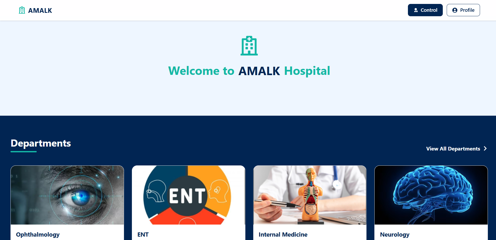
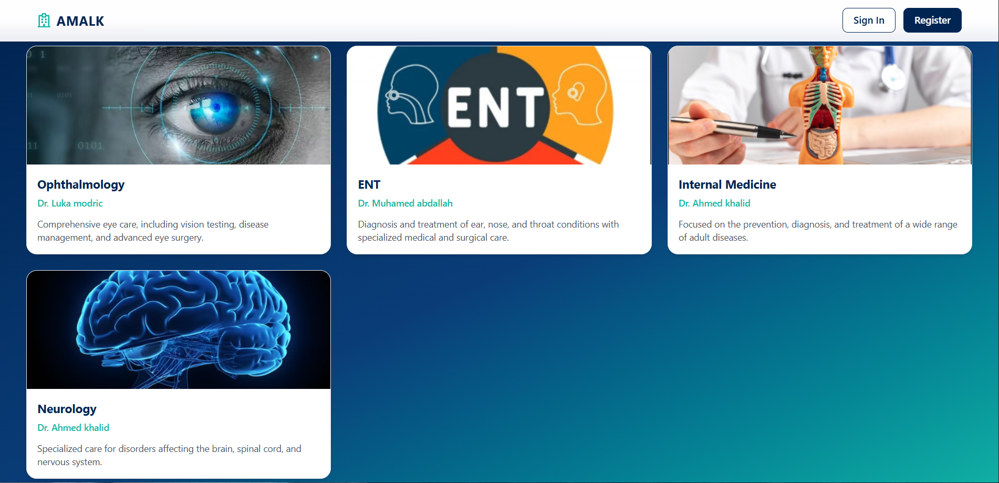
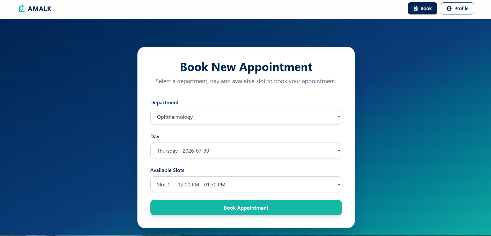
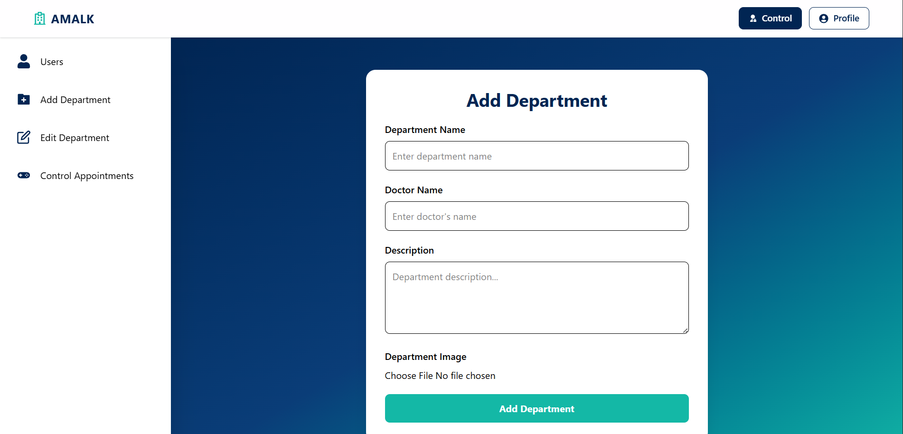

# 🏥 Hospital Appointment Booking System


A full-stack hospital appointment booking system built with the MERN Stack. The application allows patients to register, book appointments with different departments, manage their profile, and track their bookings, while administrators can manage departments and appointments through a secure dashboard.

## 🚀 Live Demo

* **Frontend:** [Live Demo](https://amalk-front.vercel.app/)
* **Backend API:** [API](https://amalk-api.onrender.com/)

---

# ✨ Features

## 👤 Patient

* Create a new account
* Secure login with JWT Authentication
* Update profile information
* Change password
* Browse hospital departments
* View department details
* Check available appointment slots
* Book appointments
* Cancel appointments
* View all personal appointments

## 👨‍💼 Admin

* Secure admin authentication
* Create new departments
* Update department information
* Delete departments
* View all appointments
* Update appointment status
* Delete appointments

---

# 🔐 Authentication & Security

* JWT Access Token Authentication
* Refresh Token Authentication using HttpOnly Cookies
* Role-based Authorization
* Protected Routes
* Password Hashing using bcrypt
* Request Validation using express-validator
* Secure API Error Handling

---

# 🛠️ Tech Stack

### Frontend

* React
* React Router
* Context API
* Axios
* Tailwind CSS

### Backend

* Node.js
* Express.js
* MongoDB
* Mongoose
* JWT
* bcrypt
* express-validator
* Multer
* Cloudinary

---

# 📌 API Highlights

### Authentication

* Register
* Login
* Logout
* Refresh Token
* Get Profile
* Update Profile
* Change Password

### Departments

* Get All Departments
* Get Department Details
* Create Department
* Update Department
* Delete Department

### Appointments

* Book Appointment
* Get My Appointments
* Cancel Appointment
* Get All Appointments (Admin)
* Update Appointment Status
* Delete Appointment

---

# 📷 Image Upload

Department images are uploaded securely using **Cloudinary**.

---

# ⚙️ Installation

## Clone the repository

```bash
git clone https://github.com/muhamedbahaa807-stack/AMALK.git
```

## Install dependencies

Frontend

```bash
cd interface
npm install
```

Backend

```bash
cd api
npm install
```

---

# ▶️ Run Locally

Backend

```bash
npm start
```

Frontend

```bash
npm run dev
```

---

# 🎯 Future Improvements

* Appointment history
* Automatic appointment completion
* Prevent booking expired time slots
* Appointment reminders
* Email and SMS notifications
* Dashboard analytics
* Pagination & filtering
* Search functionality

---

# 👨‍💻 Author

**Muhamed Bahaa**

Faculty of Computers and Artificial Intelligence
Cairo University

GitHub: [Muhamed Bahaa](https://github.com/muhamedbahaa807-stack)

LinkedIn: [Muhamed Bahaa](https://www.linkedin.com/in/muhamed-bahaa-ab7b6b370/)

---

# 📄 License

This project is created for educational and portfolio purposes.

---
# 🏗️ Built With

- React
- Node.js
- Express.js
- MongoDB Atlas
- Cloudinary
- Vercel
- Render
---
# 📸 Screenshots

## Home Page



## Departments



## Booking



## Admin Dashboard



## Log In 


